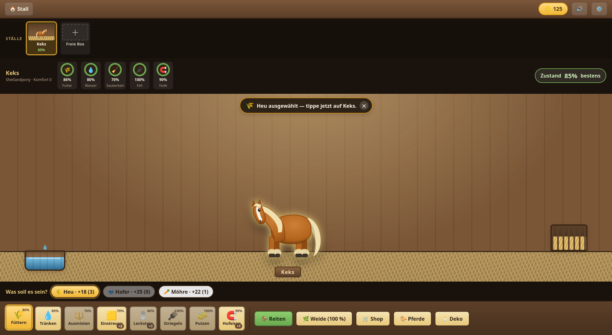
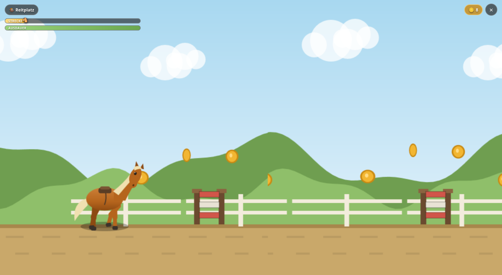

# Goldhuf — Stall & Sprung

Ein Browserspiel für junge PferdeliebhaberInnen: Pferde pflegen, Parcours springen, Münzen sammeln, den Stall
ausbauen und weitere Pferde kaufen. Reines Frontend — kein Server, kein Konto,
keine Bibliotheken.

Das ausführliche Spielkonzept steht in [KONZEPT.md](KONZEPT.md).




---

## Spielen

**[`goldhuf.html`](goldhuf.html) doppelklicken.** Die Datei enthält das gesamte
Spiel — Stile, Code, Grafiken, Musik — und läuft über `file://` ohne Webserver,
ohne Terminal, ohne Internet. Zum Weitergeben genügt diese eine Datei.


[`Demo`](https://kronenwett.com/goldhuf.html)


### Auf Handy und Tablet

Das Spiel ist für den Finger gebaut: Alles ist antippbar, nichts braucht eine
Tastatur, und das Bild passt sich Hoch- und Querformat an. Zwei Wege aufs Gerät:

* **Datei mitnehmen** — `goldhuf.html` per Cloud, Mail oder Kabel aufs Gerät
  legen und aus der Dateien-App heraus im Browser öffnen.
* **Ins Netz legen** — die Datei irgendwo ablegen, wo der Browser sie über
  `https://` erreicht (z. B. GitHub Pages). Dann lässt sie sich als Lesezeichen
  auf den Startbildschirm legen und startet wie eine App.

Der Spielstand liegt im Browser des jeweiligen Geräts — er wandert nicht mit.
Wichtig dabei: Ein Wechsel des Wegs (Datei ↔ Webadresse) ist für den Browser ein
anderer Ort, der Spielstand vom einen taucht beim anderen also nicht auf.

**Vollbild:** Am Handy geht das Spiel beim ersten Tippen im Titelmenü von selbst
in den Vollbildmodus — Adressleiste und Systemleisten verschwinden. Beim Start
eines Parcours bittet es zusätzlich um Querformat. Wer das Vollbild von Hand
verlässt, bekommt es nicht wieder aufgedrängt; ein- und ausschalten lässt es
sich jederzeit unter ⚙️ → Bildschirm. Am Rechner passiert nichts von allein —
dort bläst sich kein Fenster ungefragt auf.

Eine Ausnahme ist das **iPhone**: Safari kennt dort keinen Vollbildmodus für
Webseiten. Der Weg ist „Teilen → Zum Home-Bildschirm“ — von dort startet das
Spiel ohne Browserleiste. Die Einstellungen weisen darauf hin, wenn der Browser
kein Vollbild kann. (Das setzt voraus, dass das Spiel über eine Webadresse
geladen wurde, nicht als lose Datei.)

Für den Parcours lohnt sich das **Querformat** — hochkant bleibt vom Bild nur
ein schmaler Streifen, und das Spiel weist selbst darauf hin.

## Entwickeln

Beim Arbeiten am Quelltext lohnt der Umweg über `index.html` mit den einzelnen
Modulen. ES-Module lassen sich nicht über `file://` laden, dafür braucht es
einen kleinen lokalen Webserver:

```bash
python3 -m http.server 8000     # dann http://localhost:8000 öffnen
```

Nach Änderungen die Einzeldatei neu bauen:

```bash
python3 build.py                # -> goldhuf.html
python3 test_bundle.py          # baut und spielt die Datei einmal durch
```

`build.py` fasst die Module zu einem klassischen Skript zusammen und schreibt
Stile und Code in `index.html` hinein. Der Bundler ersetzt Text, statt zu
parsen — er trägt nur, solange das Projekt bei `import { … } from` und
`export const/function` bleibt; alles andere meldet er als Fehler.
`test_bundle.py` öffnet das Ergebnis in einem Browser ohne Fenster, klickt
sich durch alle Bildschirme, reitet ein Stück Parcours und prüft, dass dabei
kein Fehler auftritt.

## Steuerung

**Stall** — Oben links stehen alle Boxen als kleine Vorschau; ein Tipp wechselt
sofort dorthin. Das Pferd läuft frei in seiner Box umher, grast und lässt hin und
wieder Pferdeäpfel fallen. Alle Pflege findet direkt in der Box statt: unten ein
Werkzeug wählen, dann ins Bild tippen.

Mit leerer Hand lässt sich über die Box hinweg scrollen; sobald ein Werkzeug
gewählt ist, gehört die Fläche dem Striegeln, Einstreuen und Deko-Rücken, und
nichts rutscht mehr weg. Auf schmalen Bildschirmen sind Kopfzeile, Box und
Werkzeugleiste feste Zonen — Werkzeug wählen und pflegen geht ohne Scrollen.

| Werkzeug | Was zu tun ist |
|---|---|
| Füttern | Futtersorte wählen, dann aufs Pferd klicken (direkt) oder in die Raufe (Vorrat) |
| Tränken | Auf die Tränke klicken füllt sie auf; aufs Pferd geklickt, geht es gleich trinken |
| Ausmisten | Pferdeäpfel anklicken (klappt auch ohne Werkzeug) |
| Einstreuen | Mit gedrückter Maus über den Boden ziehen |
| Leckstein | An die Wandstelle klicken |
| Striegeln / Putzen | Mit gedrückter Maus über das Fell streichen |
| Hufeisen | Die vier Marken an den Hufen nacheinander anklicken |

Ein Klick aufs Pferd ohne Werkzeug ist Streicheln. Im Deko-Modus lässt sich
jedes Einrichtungsstück frei verschieben — auch der Leckstein.

**Das Pferd versorgt sich selbst.** Tränke und Raufe sind Vorräte. Wird das
Pferd durstig oder hungrig, geht es von allein hin und bedient sich — solange
etwas drin ist. Nachfüllen ist also die eigentliche Aufgabe.

**Jeder Stall wird einzeln eingerichtet.** Gekaufte Deko landet in der Box, die
gerade offen ist; für eine andere Box kauft man sie erneut. Komfort, Licht und
Pferdeäpfel gelten ebenfalls je Box.

**Weide** — Über „🌿 Weide" geht es hinaus. Draußen fressen die Pferde Gras und
werden von selbst satt; dafür werden Fell und Durst schneller zum Thema und die
Box bleibt sauber. Das Gras ist begrenzt: Ist es abgefressen, kommen alle
zurück in den Stall, und die Weide erholt sich mit der Zeit. Ab 10 % Gras darf
wieder jemand hinaus.

**Parcours**

| Wirkung | Tastatur / Maus | Finger |
|---|---|---|
| Springen (halten = höher) | Leertaste / ↑ / Klick auf die obere Hälfte | Tippen — überall auf der Fläche |
| Ducken (unter Torbögen durch) | ↓ / Klick auf die untere Hälfte | Knopf unten links halten |
| Sprint, verbraucht Ausdauer | Umschalt | Knopf unten rechts halten |
| Parcours verlassen | Esc | ✕ oben rechts |

Am Finger wird beim Springen nicht gezielt: Ein Tipp irgendwo auf der Strecke
springt. Ducken und Sprinten haben eigene Knöpfe, damit der Daumen sie ohne
Hinsehen findet.

Nach einem Sturz startet der Lauf von vorn; die Leertaste startet direkt neu.

## Aufbau

```
goldhuf.html          Das fertige Spiel als eine Datei (erzeugt, nicht bearbeiten)
build.py              Baut goldhuf.html aus index.html, css/ und js/
test_bundle.py        Spielt die gebaute Datei im Browser einmal durch
index.html            Grundgerüst mit allen Bildschirmen
css/
  base.css            Farben, Typografie, Buttons, Titelbild, Touch-Grundlagen
  ui.css              Karten, Shop, Editor, Streckenwahl, Modals
  stall.css           Stallbox, Bedürfnisse, Werkzeuge, Deko
  pasture.css         Weide und leere Box
  hud.css             Parcours-Overlay
js/
  main.js             Einstieg, Bildschirm-Router, Zeittakt, Einstellungen
  state.js            Spielzustand, Speichern/Laden, Offline-Abbau
  horse.js            Rassen, Farben, Bedürfnisse, Pferde-SVG
  catalog.js          Preise und Daten aller kaufbaren Dinge
  decorArt.js         Gezeichnete Stallausstattung (Kronleuchter, Möbel …)
  care.js             Pflegeaktionen: Daten, Verfügbarkeit, Wirkung
  stableScene.js      Die lebendige Box: Bewegung, Pferdeäpfel, Direktbedienung
  stable.js           Stallbildschirm (Bedürfnisse, Stallwechsel, Werkzeugleiste)
  pasture.js          Die Weide: Wiese, grasende Pferde, Besetzungsliste
  music.js            Hintergrundmusik als Notendaten
  shop.js             Sattelkammer
  horses.js           Pferdeauswahl
  editor.js           Pferd erstellen und umgestalten
  ride/
    levels.js         Die fünf Strecken und die Hindernismaße
    render.js         Canvas-Zeichnung (Hintergrund, Hindernisse, Pferd)
    game.js           Spielschleife, Physik, Kollision, Münzen
    select.js         Streckenwahl und Ergebnisbildschirm
  util/
    dom.js            DOM-Helfer, Modals, Toasts, Drag
    audio.js          Klänge und Pferdelaute über die Web Audio API
    fullscreen.js     Vollbild und Querformat-Sperre fürs Handy
```

Alle Grafiken entstehen im Code (SVG bzw. Canvas), alle Geräusche und die
Musik werden zur Laufzeit synthetisiert. Es gibt keinen `assets/`-Ordner und
nichts nachzuladen.

## Ton und Musik

Geräusche und Musik lassen sich in den Einstellungen (⚙️) getrennt ein- und
ausschalten. Die vier Musikstücke — Stallwalzer, Galoppstück, Nachtfassung und
Titelversion — stehen als Notendaten in `js/music.js` und laufen über einen
kleinen Zeitplaner der Web Audio API. Das entspricht inhaltlich einer
MIDI-Datei, kommt aber ohne Datei und ohne SoundFont aus. Wer echte MIDI-Dateien
einbinden möchte, bräuchte zusätzlich einen MIDI-Player und einen SoundFont
(mehrere MB) — siehe KONZEPT.md, Abschnitt 13.4.

## Spielstand

Der Spielstand liegt unter dem Schlüssel `goldhuf.save` im `localStorage` des
Browsers. Zurücksetzen geht über ⚙️ → „Spielstand zurücksetzen".

Einrichtung und Pferdeäpfel stehen beim jeweiligen Pferd (`horse.decor`,
`horse.muck`). Ältere Spielstände, in denen beides noch allen Ställen gemeinsam
war, werden beim Laden übernommen: Die bisherige Einrichtung bekommt **jeder**
Stall als eigene Kopie, damit niemand etwas verliert.

Abwesenheit wird beim Laden angerechnet, aber auf **8 Stunden gedeckelt** —
nach einer langen Pause steht also kein völlig verwahrlostes Pferd im Stall.

## Balance an einer Stelle ändern

| Was | Wo |
|---|---|
| Preise, Komfortwerte, Vorratsmengen | `js/catalog.js` |
| Münzwert, Sprungkraft, Schwerkraft, Ausdauer | Konstanten oben in `js/ride/game.js` |
| Bedürfnisabbau, Rassenwerte, Kosten eines Ritts | oben in `js/horse.js` |
| Lauftempo, Häufigkeit von Pferdeäpfeln, Durst-/Hungerschwelle | Konstanten oben in `js/stableScene.js` |
| Grasverbrauch, Nachwachsen, Sättigung auf der Weide | `PASTURE` in `js/state.js` |
| Melodien, Tempo, Instrumente | `js/music.js` |
| Streckenaufbau, Hindernismaße, Freischaltgrenzen | `js/ride/levels.js` |

## Testen

`window.__ride` gibt im Parcours Einblick in den laufenden Zustand
(`player`, `level`, `coins`, `crashed`, `finished`) und erlaubt mit
`__ride.step()` einen einzelnen Physikschritt sowie `__ride.pressJump()` /
`__ride.releaseJump()`. Damit lässt sich ein kompletter Lauf ohne Bildausgabe
durchsimulieren — so wurde geprüft, dass alle fünf Strecken auch mit dem
schwächsten Pferd (Shetlandpony) zu schaffen sind.

`window.__scene` tut dasselbe für die Stallbox: `step(dt)` treibt Bewegung,
Verhalten und Apfeltimer voran, `anim` zeigt Position und Verhalten,
`dropApple()` löst sofort einen Haufen aus. Ohne diesen Zugang lässt sich die
Box nicht automatisiert prüfen, weil `requestAnimationFrame` im Headless-Browser
nicht läuft.

`window.__pasture` bietet `step(dt)` für die Weide-Animation.

`window.__goldhuf` bietet dasselbe für den Spielstand (`state`, `save`,
`load`, `resetGame`).

`python3 test_bundle.py` nutzt genau diese Zugänge: Es baut `goldhuf.html`,
öffnet die Datei über `file://` in einem Browser ohne Fenster und läuft den
Weg eines neuen Spiels ab — Pferd anlegen, Stall, Weide, Shop, Pferdeauswahl,
Streckenwahl, ein Stück Parcours mit Sprung, zurück in den Stall. Der Test
schlägt an, sobald ein Bildschirm leer bleibt, ein Knopf fehlt oder eine
Ausnahme fliegt. Er ersetzt nicht das eigene Nachsehen im Browser, fängt aber
alles ab, was der Bundler kaputtmachen kann.

Der zweite Durchlauf ist dasselbe Spiel als **Handy**: Chromium bekommt ein
Fenster in Handygröße und meldet einen groben Zeiger, womit dieselben Media
Queries greifen wie auf einem echten Gerät. Die Probe bedient das Spiel dann
mit echten Touch-Ereignissen und prüft, was am Finger schiefgehen kann —
striegelt das Wischen über das Fell wirklich, springt ein Tipp unten auf der
Strecke, wirken Duck- und Sprintknopf, bleibt kein Knopf gedrückt hängen, ragt
nichts seitlich hinaus, ist jedes Tippziel groß genug. Ein Kunstgriff steckt
darin: Selbst erzeugte Zeiger kennt der Browser nicht, `setPointerCapture`
würde daran scheitern — für den Testlauf wird die Methode deshalb stillgelegt.

Vollbild und Querformat lassen sich ohne echte Nutzergeste nicht auslösen.
Geprüft wird deshalb, ob das Spiel **danach fragt**: Attrappen für
`requestFullscreen` und `screen.orientation.lock` zählen die Aufrufe. Am Handy
müssen beide kommen, am Rechner keiner. Ob der Browser die Bitte dann auch
erfüllt, zeigt erst ein echtes Gerät.
